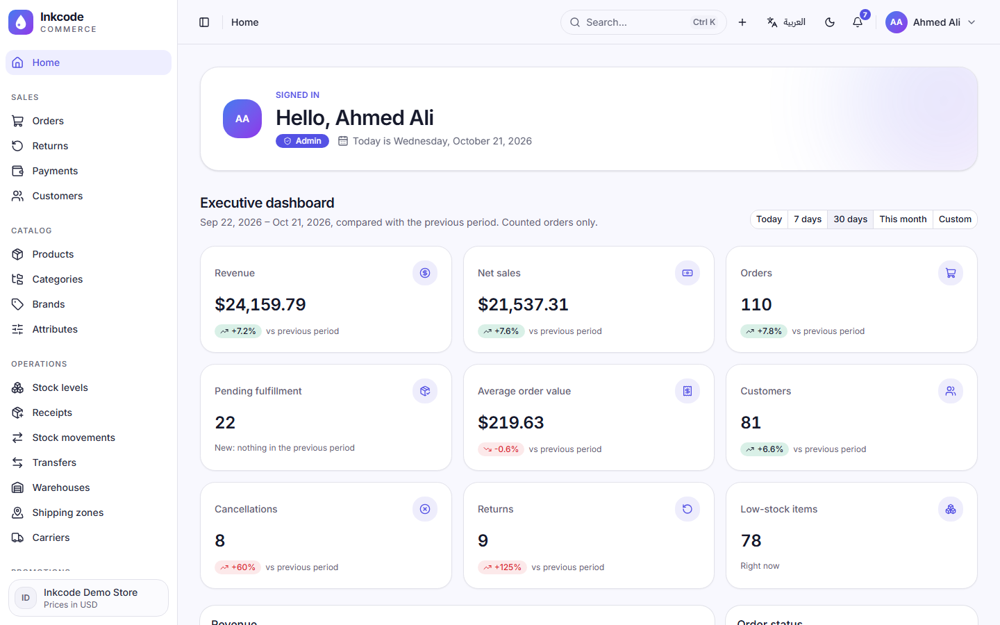
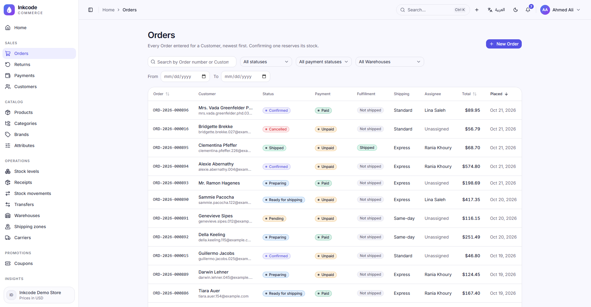
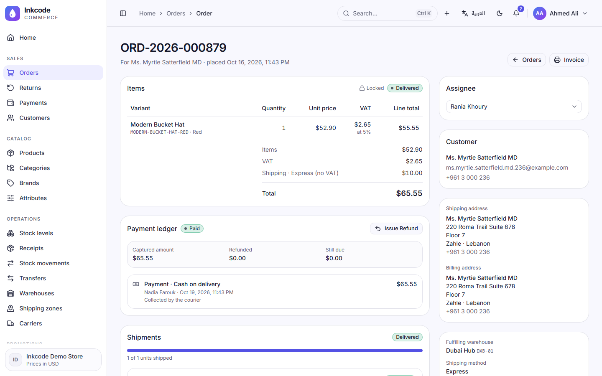
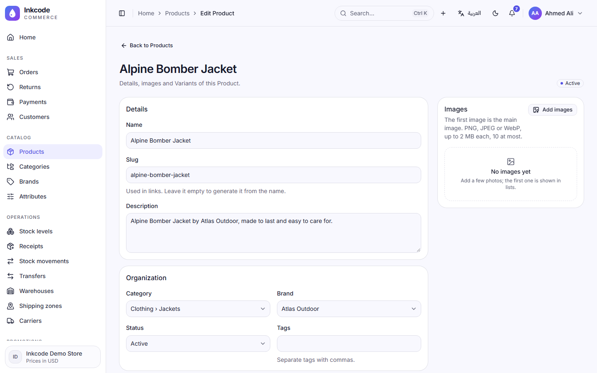
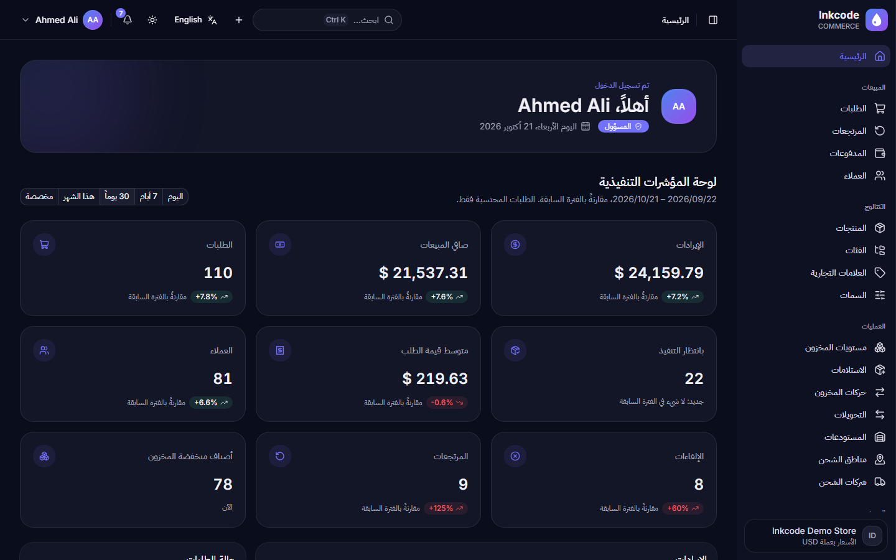
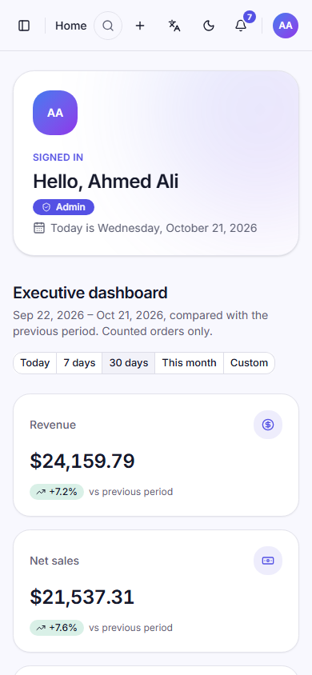

# INKCODE Commerce: E-Commerce Management Dashboard

A full-stack e-commerce administration platform built for the INKCODE engineering assessment: a React + TypeScript single-page app (static build) talking to a versioned Laravel REST API backed by MySQL.

> **Status:** every module in the brief is built and connected to the API and MySQL: dashboard, catalog with Variants, Customers, inventory across Warehouses, Orders and fulfillment, payments, Coupons, shipping, Returns and Refunds, reports with CSV/Excel export, Users & Roles, notifications, audit log, settings and global search. The demo store is seeded at the brief's scale (200 Products, 1,000 Orders, 300 Customers, 3 Warehouses). What is still incomplete is listed under [Incomplete / assumptions](#incomplete--assumptions).

## Screenshots

Taken from the running app with the seeded demo store. All of them are in [docs/screenshots](docs/screenshots/).

| Executive dashboard | Orders (Order, Payment and Fulfillment statuses) |
|---|---|
|  |  |
| **Order detail** | **Product with generated Variants** |
|  |  |
| **Arabic, right to left, dark theme** | **Phone layout** |
|  |  |

## Tech stack

| Layer | Technology |
|---|---|
| Frontend | React 19, TypeScript 7 (strict), Vite 8, Tailwind CSS 4, shadcn/ui 4 (Radix), React Router 8, TanStack Query 5, TanStack Table 9, React Hook Form + Zod 4, Recharts 3, Axios, i18next (English / Arabic RTL), GSAP + Lenis |
| Backend | Laravel 13 (PHP 8.4), Sanctum (SPA cookie auth), API Resources, Form Requests, Policies, spatie/laravel-permission 8, Scramble (OpenAPI) |
| Database | MySQL 8.4 (migrations, foreign keys, indexes, seeders) |
| Quality | Pest 4, Larastan, Pint, Vitest 5, Testing Library, Playwright, oxlint, Prettier, GitHub Actions CI, Dependabot |

## Supported versions

| Tool | Version |
|---|---|
| PHP | 8.4 (8.3+ supported by Laravel 13) with `pdo_mysql`, `mbstring`, `intl`, `bcmath`, `gd`, `zip`, `fileinfo`, `openssl`, `curl` |
| Composer | 2.x |
| Node.js | 24 LTS (npm 11) |
| MySQL | 8.4 (via Docker Compose, or any local MySQL 8+) |
| Docker | Docker Desktop / Engine with Compose v2 (only needed for MySQL) |

## Installation

### 1. Clone and start MySQL

```bash
git clone https://github.com/mohamadkheiredine/INKCODE-Ecommerce.git
cd INKCODE-Ecommerce
docker compose up -d mysql
```

This starts MySQL 8.4 on port 3306 with a local-only `inkcode` / `secret` user, the `inkcode` database and an `inkcode_testing` database for the test suite. To use your own MySQL instead, create both databases and update `backend/.env`.

### 2. Backend API

```bash
cd backend
composer setup        # composer install, copy .env, generate key, migrate + seed
composer dev          # http://localhost:8000
```

`composer setup` copies `.env.example` to `.env`. Key variables:

| Variable | Example | Purpose |
|---|---|---|
| `APP_URL` | `http://localhost:8000` | API base URL |
| `DB_HOST` / `DB_PORT` | `127.0.0.1` / `3306` | MySQL connection |
| `DB_DATABASE` / `DB_USERNAME` / `DB_PASSWORD` | `inkcode` / `inkcode` / `secret` | Local-only credentials |
| `FRONTEND_URL` | `http://localhost:5173` | Allowed CORS origin (credentials enabled) |
| `SANCTUM_STATEFUL_DOMAINS` | `localhost:5173,127.0.0.1:5173` | Hosts that get cookie-based SPA auth |
| `SESSION_DOMAIN` | `null` locally, `.example.com` in production | Session cookie scope |
| `DEMO_MODE` | `true` | Seeds the demo store and one demo account per Role (local/review only) |
| `DEMO_FULL_SCALE` | `true` | With demo mode: 200 Products and 1,000 Orders over the last year; `false` keeps the small demo store |
| `DB_EMULATE_PREPARES` | `false` | Set `true` on **Docker Desktop for Windows**, whose port proxy adds ~40 ms to every native prepared statement (seeding drops from over an hour to a few minutes) |

#### Demo data

Seeding in demo mode builds the store the brief asks for, entirely through the same actions the API uses, so every total, stock balance, Payment and report agrees: **200 Products** (about 1,100 Variants from Color × Size × Material, Draft and Archived ones included), **1,000 Orders** spread over the last 12 months in every status (Pending to Delivered, Cancelled, partial Shipments), **300 Customers** in every Segment, **3 active Warehouses** (plus a deactivated one) with Receipts, Adjustments and Transfers, Cash on delivery / Manual / Card payments (some declined first), goodwill Refunds, Returns at every step with Restock and Write-off decisions, Coupons, and the audit trail of all of it. A fixed random seed shapes it, so every fresh seed builds the same kind of store with dates relative to the day you seed. [docs/demo-data-checks.sql](docs/demo-data-checks.sql) proves the result is consistent: every query in its "must be zero" section returns 0.

### 3. Frontend SPA

```bash
cd frontend
npm ci
cp .env.example .env.local   # VITE_API_URL stays empty: the dev server forwards /api to Laravel
npm run dev                  # http://localhost:5173
```

### 4. Open the app

Open **http://localhost:5173** and sign in with one of the [demo accounts](#demo-accounts); the sign-in page has a one-click button for each Role.

## Running the project (after the first install)

You need three things running: the database, the API and the SPA. Open Docker Desktop, then from the project folder run each command in its **own terminal** (the servers keep running until you press `Ctrl+C`):

```bash
docker compose up -d mysql                  # 1. MySQL 8.4 on port 3306
php backend/artisan serve --port=8000       # 2. Laravel API on http://localhost:8000
npm --prefix frontend run dev               # 3. React SPA on http://localhost:5173
```

Then open **http://localhost:5173**.

- New database tables or demo data after pulling changes: `php backend/artisan migrate --seed`
- Start over with fresh demo data: `php backend/artisan migrate:fresh --seed`
- Browse the data with any MySQL client (DBeaver, HeidiSQL, TablePlus): host `127.0.0.1`, port `3306`, database `inkcode`, user `inkcode`, password `secret` (local-only). Leave `inkcode_testing` alone: the test suite wipes it on every run.

### Demo accounts

With `DEMO_MODE=true` (the default in `backend/.env.example`), seeding creates one demo account per Role, and the sign-in page shows one-click buttons for them. These are **local-only test credentials**: never enable demo mode in production.

All demo accounts use the password **`password`**.

| Role | Email | What this Role can do |
|---|---|---|
| Admin | `admin@inkcode.test` | Everything, including Users & Roles, settings and the audit log |
| Operations | `operations@inkcode.test` | Catalog, Orders (create, edit, move through the flow, cancel, assign), Shipments, shipping setup |
| Inventory | `inventory@inkcode.test` | Warehouses, stock, Receipts, Adjustments, Transfers, receiving and restocking Returns |
| Sales | `sales@inkcode.test` | Customers, Orders (create, edit, cancel, assign), Coupons |
| Support | `support@inkcode.test` | Customers, requesting and approving Returns |
| Finance | `finance@inkcode.test` | Payments, Refunds, reports and exports |
| Viewer | `viewer@inkcode.test` | Read-only access to everything except the audit log |

Every permission is checked by the API on each request; the interface only hides what a Role cannot use. The full matrix is in `backend/app/Enums/Role.php`.

## Testing

```bash
# Backend: Pest feature + unit + architecture tests on MySQL (inkcode_testing)
cd backend && composer test

# Backend: full gate (Pint + Larastan + tests)
cd backend && composer check

# Frontend: unit/component tests
cd frontend && npm test

# Frontend: full gate (typecheck + oxlint + Prettier + Vitest)
cd frontend && npm run check

# End-to-end (Playwright, desktop + mobile); needs the backend running
cd frontend && npx playwright install chromium && npm run test:e2e
```

Latest executed results are recorded in [docs/test-results.md](docs/test-results.md).

## API documentation

- Interactive OpenAPI docs: http://localhost:8000/docs/api (Scramble, local environment only)
- Exported spec: `composer api-docs` writes [docs/api/openapi.json](docs/api/) (importable into Postman)
- All endpoints are versioned under `/api/v1`.

## Production build

```bash
# Frontend: static files in frontend/dist, deployable to any static host / CDN
cd frontend && npm ci && npm run build

# Backend
cd backend
composer install --no-dev --optimize-autoloader
php artisan migrate --force
php artisan config:cache && php artisan route:cache && php artisan view:cache
```

### Deployment notes

- **Two deployables.** `frontend/dist` is plain static files for any static host or CDN (serve `index.html` for unknown paths, since the SPA routes on the client). The Laravel API runs on PHP 8.4 behind Nginx or Apache with MySQL 8.
- **One registrable domain** for Sanctum cookie auth, for example `admin.example.com` (SPA) and `api.example.com` (API). See [ADR 0002](docs/adr/0002-sanctum-spa-cookie-authentication.md).
- **SPA build variable:** `VITE_API_URL=https://api.example.com` (empty only in development, where Vite forwards `/api`).
- **API variables:** `APP_ENV=production`, `APP_DEBUG=false`, `APP_URL=https://api.example.com`, `FRONTEND_URL=https://admin.example.com`, `SANCTUM_STATEFUL_DOMAINS=admin.example.com`, `SESSION_DOMAIN=.example.com`, `SESSION_SECURE_COOKIE=true`, and **`DEMO_MODE=false`** (no demo accounts or quick logins).
- **Release steps:** `composer install --no-dev --optimize-autoloader`, `php artisan migrate --force`, `php artisan db:seed --force` (Roles and permissions only when demo mode is off), `php artisan storage:link` (product images and logos), then `php artisan optimize`. Create the first Admin with `php artisan tinker` or a one-off seeder.

## Project documents

- [docs/requirements.md](docs/requirements.md): requirement checklist by phase
- [docs/SUBMISSION.md](docs/SUBMISSION.md): submission checklist
- [docs/engineering-note.md](docs/engineering-note.md): architecture decisions, AI tools used, limitations
- [docs/adr/](docs/adr/): architecture decision records

## Status

### Done

- Repository structure, Docker MySQL, Laravel API foundation (`/api/v1`, Sanctum, permissions, OpenAPI), React SPA foundation (Tailwind, shadcn/ui with RTL, routing/data/form/i18n/animation libraries), test tooling and CI.
- **Staff sign-in with Roles (#6):** sign in and out with session cookies and CSRF, rate limiting, the seven Roles and their permission matrix, demo accounts, the shared JSON error format, English/Arabic and light/dark sign-in screens.
- **App shell, design system and profile (#7):** a sidebar built from one permission-aware registry (icon rail on tablets, drawer on phones), breadcrumbs, a header with language and theme switches and a user menu; English ↔ Arabic mirrors the layout with Western digits; language and theme are kept on the User and follow them to any device; a profile page to change the password (current password, minimum strength, other sessions signed out); shared skeleton, empty, error and toast patterns; GSAP entrances and Lenis smooth scrolling, all off under reduced motion.
- **In-app notifications (#8):** a bell in the header with the unread count; it lists the User's own notifications newest first, opens the record each one links to, and marks one or all as read. It checks every 30 seconds while the tab is visible and pauses while it is hidden. Messages follow the interface language (English or Arabic), and demo accounts start with a welcome notification.

- **Categories and Brands, shared lists, forms and audit trail (#9):**
  - Categories come in two levels (a child never has children) and Brands can have an optional PNG, JPEG or WebP logo.
  - Both have unique slugs generated from the name, and lists with search, filters, sorting and pages. The list state lives in the URL, so links can be shared and back/forward works.
  - Creating and editing happen in dialogs, with server validation errors shown under the matching field. Deleting asks for confirmation, and a parent that still has children (or a record still in use) is refused with a clear message.
  - Every Role can view the catalog; only Admin and Operations can change it, and the API enforces this.
  - Every change, including profile preferences and password changes, writes an audit entry with who did it and the values before and after.
- **Customers with addresses, Tags and notes (#13):**
  - A Customer has a name and an email, a phone or both; an email belongs to one Customer. The list searches by name, email or phone, filters by Tag and sorts by name or date.
  - Several addresses per Customer, always with exactly one default billing and one default shipping address: the first address takes both, another can take either over, and removing a default hands it to the oldest remaining address. MySQL itself refuses a second default.
  - Tags are typed freely (or picked from existing ones) and created on save; internal notes are signed by their author and timestamped, and are never edited.
  - Admin, Sales and Support manage Customers; Operations, Finance and Viewer only look; Inventory has no access. Every change is audited. 300 demo Customers are seeded.
- **Shipping zones, Shipping methods and Carriers (#14):**
  - A Shipping zone covers whole countries or single cities; a place belongs to one zone only. Each zone has flat-price Shipping methods (price, estimated delivery days, active flag).
  - Quoting an address checks the city first, then the country, and offers the zone's active methods cheapest first; an address no zone covers gets no methods and a clear message. The Shipping zones page has a "Check an address" card that asks the same quote Order creation will.
  - Carriers have an optional tracking link template holding `{tracking_number}`, with a live example in the form.
  - Roles that see Orders can look; only Admin and Operations change shipping, and every change is audited.

- **Shipments and Partial fulfillment (#18):**
  - Operations and Inventory Users ship a Ready for shipping Order in one or several Shipments, each with a Carrier, a tracking number (linked to the Carrier's tracking page) and the units of each line it carries, never more than a line has left to ship. They mark Shipments delivered; each Shipment keeps its status history.
  - The Order becomes Shipped once everything still ordered has shipped, and Delivered once all its Shipments are delivered. Shipment progress (Not shipped, Partially shipped, Shipped, Delivered) shows apart from the Order status, and every step appears in the Order timeline and the audit log.
  - Stock leaves On-hand exactly once: on entering the Deduction stage (Preparing or Ready for shipping), or Shipment by Shipment when it is Shipped, even if the setting changes while an Order is on its way.

- **Store settings (#15):**
  - The Admin edits the store profile and logo, the Store currency (code and symbol), the VAT rate (5% by default), the Deduction stage (Shipped by default), the Return window (14 days), the default Low-stock threshold (5) and the language and theme new Users start with. Each business setting is explained on screen in English and Arabic, with a live preview of how amounts will look.
  - Settings live in one typed, database-checked row, are cached for every module that reads them, and every change writes an audit entry. Only the Admin can see or change them all; every signed-in User sees the store's name, logo and currency in the sidebar.
  - Every amount in the SPA is written in the Store currency with its chosen symbol, always to the cent.

- **Warehouses, stock levels and Receipts (#11):**
  - Warehouses (name, code, address) can be created, edited and deactivated once empty. Stock levels show On-hand, Reserved, Available and Stock value for every Variant in every Warehouse, filtered by Warehouse, Product, Category and low stock.
  - Every stock change goes through one service (ADR 0008) that locks rows in a fixed order and appends a Stock movement, so balances always equal their movements. Receipts re-weight the Average cost (ADR 0005) and are safe to retry with an `Idempotency-Key`. A multi-process test proves concurrent Receipts stay consistent.
- **Products with generated Variants (#10):**
  - A shared Attribute library (Size, Color, Material…) whose values are unique within each Attribute and carry the codes SKUs are made of.
  - Products have a Category, an optional Brand, a base price (without VAT), a taxable flag, tags, SEO fields, a status (Draft / Active / Archived) and up to ten images. Images can be reordered, and the first one is the main image.
  - Picking 3 Colors × 4 Sizes generates 12 Variants. Each gets a readable, unique SKU (`CLASSIC-TEE-RED-M`) and the base price. Generating again only adds the missing combinations and keeps existing Variants. SKU, price, Average cost and Low-stock threshold are edited in place, and a taken SKU is refused under its field.
  - The list searches by name or SKU, filters by status, Category (a top-level one includes its children), Brand and price range, sorts by name, price and date, and supports bulk activate, archive and delete-where-allowed.

- **Audit log (#26):**
  - The Admin searches every recorded change by record name and filters by record type, action, User and date range; each entry opens a side-by-side view of the values before and after, and links to the record's page where it has one. Entries are read-only.
  - The demo store comes with a two-week history of its setup by the demo Users.

- **Coupons (#20):**
  - A Coupon takes a percentage or a fixed amount off an Order, from its start date to its optional end date, within a total and a per-Customer usage limit, above a minimum order amount, and optionally only on chosen Products or Categories (a Category includes its sub-categories). An Order carries at most one Coupon.
  - One validator serves the live quote, creating and editing an Order, and Confirm, with a clear reason when a code does not apply (not started, expired, limit reached, below the minimum, no eligible items). The discount is spread over the eligible lines by value (the leftover cent goes to the largest line), and VAT is charged on the discounted amounts.
  - A use counts when the Order is Confirmed (the Coupon row is locked, so the last use goes to one Order even under simultaneous confirmations) and is freed when the Order is fully cancelled. Each Coupon's page lists the Orders and Customers that used it.
  - Admin and Sales manage Coupons; Operations, Finance and Viewer only look; Inventory and Support have no access. Five demo Coupons are seeded, and every third demo Order uses `SAVE10`.
- **Executive dashboard (#23):**
  - The landing page shows nine KPIs for a date range (today, 7 days, 30 days, this month or custom, kept in the URL): Revenue, Net sales, Orders, pending fulfillment, Average order value, Customers, cancellations, Returns and low-stock items, each compared with the previous period of the same length ("New" when that period had nothing). There is no conversion rate, because visits are not tracked.
  - A daily Revenue chart against the previous period, an Order-status donut, top Products, recent Orders and alerts (low stock, Pending Orders, Returns awaiting a decision) complete it. KPI count-up and chart animations are off under reduced motion.
  - Every figure comes from Counted orders (Confirmed or later, not Cancelled, dated by the day placed) through one shared scope, `Order::counted()`, for the reports and Lifetime value to reuse. Revenue always equals the sum of those Orders' totals.
- **Reports with CSV and Excel export (#24):**
  - Six reports under Insights → Reports: Sales (by day, week or month), Products (top sellers by sales or units), Categories (with each one's share), Customers (top spenders, New vs Returning), Returns (by reason, with the return rate) and Inventory (stock per Variant, low stock, Stock value). Each has the dashboard's date range in the URL and a summary compared with the previous period.
  - Admin and Finance download any report as CSV or Excel (.xlsx), named like `sales-report-2026-09-21-to-2026-10-20.xlsx`: the same rows as the screen, headers in the User's language, numbers stored as real numbers. Exporting is its own permission (`reports.export`); Operations, Inventory, Sales and Viewer only view, and Support has no access.
  - A test checks that the reports' totals equal the dashboard's for the same range.
- **Adjustments, Transfers and low-stock alerts (#12):** reasoned stock corrections, Transfers between Warehouses (Draft → In transit → Received) and a bell alert when a Variant drops to its Low-stock threshold, all through the stock service and its movement ledger.
- **Orders with stock reservation (#16) and the Order flow (#17):** a live quote (VAT, shipping, Coupon) while an Order is entered; Confirm reserves stock under row locks, so simultaneous Orders never oversell (proved by a multi-process test). The flow Pending → Confirmed → Preparing → Ready for shipping → Shipped → Delivered lives in one state machine; any other jump gets 409. Lines and addresses lock from Preparing on. Partial cancellation, Assignees, notes, a timeline and a printable Invoice complete the Order page. The list shows Order, Payment and Fulfillment statuses, Shipping method and Assignee.
- **Payment ledger (#19):** Cash on delivery, Manual and mock Card payments (approve or decline) and Refunds are rows in one append-only ledger, from which the Payment status is derived. Every write takes an `Idempotency-Key`, Refunds can never exceed what was captured, and a reconciliation view compares each Order's total with its ledger.
- **Returns (#21):** Requested → Approved → Received → Restock decision (Restock or Write-off, per line) → Refund. Stock only comes back on an explicit Restock, and the Refund is capped by what the store still holds for the Order.
- **Customer Lifetime value and Segments (#22):** VIP, Regular, At risk and New, computed from Counted orders and the ledger, filterable on the Customers list.
- **Users & Roles (#25):** the Admin creates, edits, deactivates and reactivates Users and sees the read-only permission matrix. The last active Admin cannot be removed.
- **Global search and quick actions (#27):** a command palette (Ctrl/⌘ K) searches Orders, Products and Customers (only the groups the User's Role may list) and offers the quick actions that Role allows.

### Incomplete / assumptions

- **Not built:** a one-command Docker stack for the API and SPA (MySQL runs in Docker; the API and SPA run with the commands above). Playwright covers sign-in, the app shell, catalog, Products with Variants, inventory, Customers, Orders (create, confirm, cancel), shipping, settings, Users and the audit log; the remaining demo scenarios (concurrency, the full lifecycle, Returns and Refunds, financial reconciliation, least privilege) are proven by Pest feature and multi-process concurrency tests instead of browser tests.
- Demo Products have no images: the image upload works (up to ten per Product), but the seeders do not generate picture files.
- **An Order carries at most one Coupon** (no stacking): the simplest unambiguous stacking rule. A second code replaces the first.
- Cancelling units of an Order that are already past the Deduction stage but not shipped puts them back On-hand at once. They never left the Warehouse, so this is not a Return restock; shipped units can only come back through a Return.
- Marking a notification as read is the User's own reading state and is not audited. Categories and Brands that Products use cannot be deleted (restricting foreign keys).
- A Product or Variant that appears on an Order can only be archived, never deleted. This holds once Order lines reference Variants with a restricting foreign key (#16). Stock per Warehouse arrives with #11, and a Variant's empty Low-stock threshold follows the store default from Settings (#15).
- Lifetime value and Segments are computed in SQL on every request from Counted orders and the Payment ledger (#22), so they are always current and need no recalculation job. Refusing to delete a Customer who has Orders relies on the restricting foreign key Orders add in #16.
- Notifications are raised for low stock, an Order assigned to you, a declined card payment and a requested Return; they are checked every 30 seconds rather than pushed.
- A User with no Role, or a deactivated User, cannot sign in; deactivating a User ends their sessions at once. The Admin manages Users and sees the read-only Roles & permissions matrix (#25).
- Changing the Store currency relabels amounts; it never converts them (one currency, no exchange rates). The default language and theme apply to Users created from #25 on.
- Conversion rate will only be shown if visit/session tracking is implemented; otherwise it is intentionally omitted.
- Payments use a mock gateway adapter. No live payment provider is integrated (per the brief).
